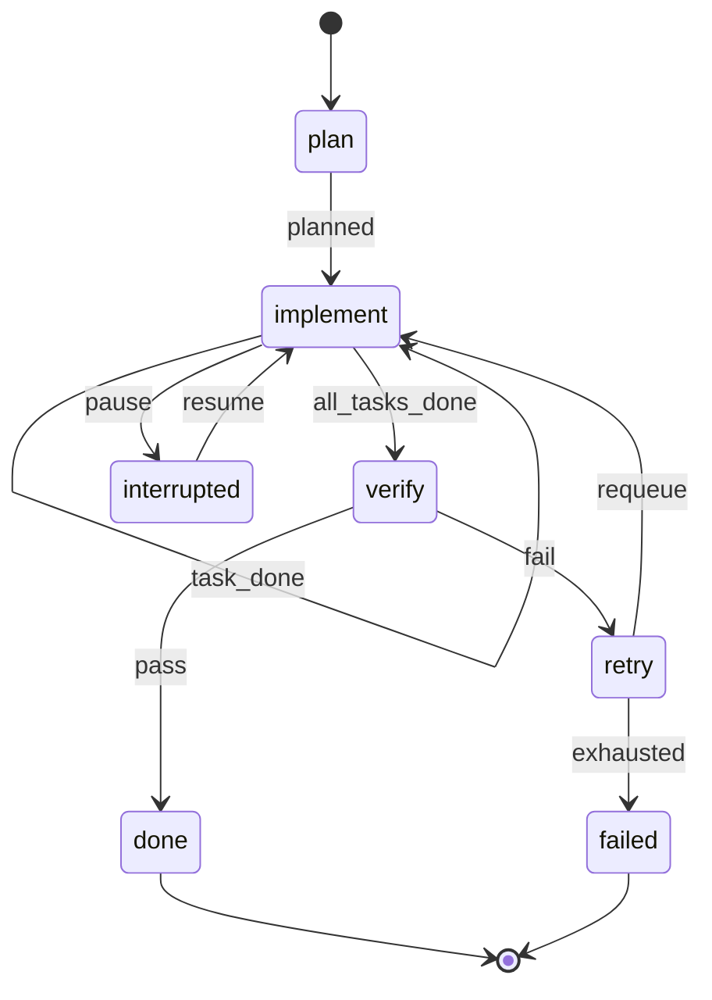
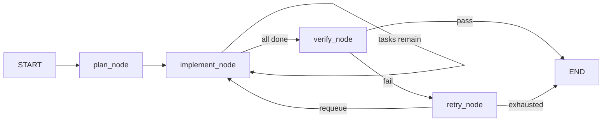

# v1-01 Proposed Python Project Structure

Logged: `[Structure.propose]`.

## Package layout (target)

```text
src/lean_weave/
  __init__.py          # lean_weave:main → CLI dispatch (keep)
  cli/                 # argparse / future Typer thin layer
  providers/           # LLMProvider DeepSeek impl (later plans)
  context/             # ContextProvider
  orchestrator/        # minimal SM WorkflowOrchestrator
  executor/            # CodeExecutor
  verify/              # VerificationRunner
  state/               # StateStore (.lean-weave/)
  metrics/             # MetricsCollector
  schemas/             # Pydantic models (exists)
  contracts/           # Protocol modules (exists)
spikes/                # bounded probes (exists; not production)
tests/                 # spikes / schemas / contracts / later unit
.lean-weave/           # runtime FeatureState (gitignored)
.ai-factory/          # DESCRIPTION, ARCHITECTURE, plans, adr, references
docs/                  # human docs (architecture.md)
```

Module count (proposed top-level packages under `lean_weave`): **10** (+ schemas/contracts already present).

## Entrypoint decision: `src/main.py` vs `lean_weave:main`

| Option | Decision |
|--------|----------|
| `lean_weave:main` (`project.scripts`) | **Canonical** product CLI entry |
| `src/main.py` PyCharm sample | **Remove in a later chore** (or rehome under `examples/` if IDE demo needed). Not part of architecture runtime. |

Rationale: avoids dual entrypoints; uv/script packaging already points at the package.

## Chosen orchestrator transitions (minimal SM)



## Deferred LangGraph state/transition design

Kept for deliverable completeness (ADR-002 defers adoption):



- Graph state ≈ `FeatureState` fields; `thread_id = feature_id`.
- Checkpointer: Sqlite under `.lean-weave/checkpoints.sqlite` if revisited.
- Ephemeral tool-loop messages **outside** durable graph state.

## AI Factory artifact locations

Unchanged from config: `.ai-factory/{DESCRIPTION,ARCHITECTURE,plans,adr,references}/`.
